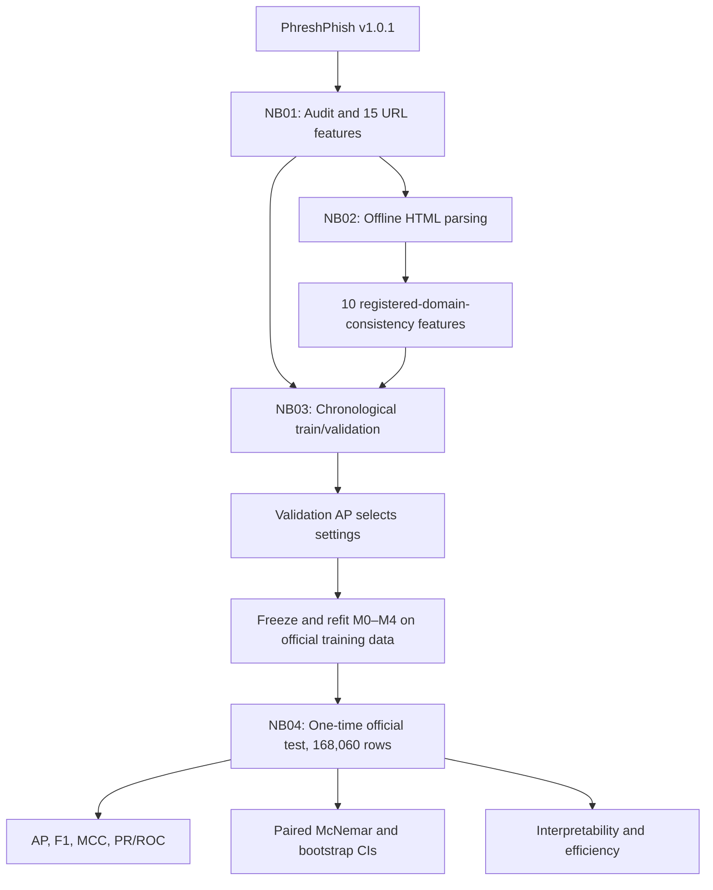

<div align="center">

<sub>MSC COMPUTER SCIENCE RESEARCH · PHISHING DETECTION · TEMPORAL EVALUATION</sub>

# Phishing Website Detection
### Lightweight · Interpretable · Time-Aware

**Can a website's HTML references tell us what its URL alone cannot?**

A reproducible four-notebook study comparing **15 conventional URL features** against **25 URL + HTML registered-domain-consistency features** using PhreshPhish v1.0.1.

[](https://www.kaggle.com/code/abarman79/04-final-temporal-evaluation-and-interpretation)
[](Results/Notebook%204/manifests/manifest_nb04.json)
[](Results/Notebook%204/reports/final_result_values_for_thesis.md)

**4 notebooks** · **5 frozen model configurations** · **168,060 official-test examples** · **30 research figures**

</div>

---

## The result, before the methodology

| Strongest model | Official-test Average Precision | F1 | MCC |
|---|---:|---:|---:|
| **M4 · Random Forest + URL/HTML consistency** | **0.9780** | **0.9131** | **0.8510** |

The controlled comparison finds improved detection when the same estimator is supplied with additional **HTML registered-domain-consistency** features. Both the Logistic Regression and Random Forest hybrid configurations outperform their URL-only counterparts on the official test set.

> **Evidence boundary:** These are offline measurements on stored website snapshots, not a deployed phishing-prevention service. The official train/test boundary shares benign observations dated 2025-09-08; the official split is therefore **not globally strictly later by calendar date**.

**Quick navigation:** [Research question](#research-question) · [Experiment map](#experiment-map) · [Dataset](#dataset-and-time) · [Results](#official-test-results) · [Interpretability](#what-the-models-learned) · [Reproducibility](#reproducibility) · [Limitations](#limitations-and-research-integrity)

## Research question

> To what extent can a compact and interpretable set of URL–HTML registered-domain-consistency features improve lightweight phishing website detection beyond conventional URL features when evaluated on temporally separated webpages?

This is a **feature-comparison study**, not a competition to try unlimited model types. The two predefined comparisons are **M2 − M1** (Logistic Regression) and **M4 − M3** (Random Forest). Data partitions, preprocessing, hyperparameters, evaluation samples and metrics were controlled before final-test exposure.

## Experiment map



### Four notebooks: the evidence trail

| Stage | Notebook | What it delivers | Kaggle |
|---|---|---|---|
| **01 · Audit** | [Data audit & URL features](notebooks/01_data_audit_and_url_features.ipynb) | Data integrity, chronological description, 15 URL features, F01–F07 | — |
| **02 · Enrich** | [HTML consistency features](notebooks/02-html-domain-consistency-features.ipynb) | Offline extraction, 10 retained HTML features, F08–F12 | [Open](https://www.kaggle.com/code/abarman79/02-html-domain-consistency-features) |
| **03 · Freeze** | [Temporal validation and model selection](notebooks/03_temporal_validation_and_model_selection.ipynb) | Later-date validation, fixed model choices, refit on official train, F13–F18 | [Open](https://www.kaggle.com/code/abarman79/03-temporal-validation-and-model-selection) |
| **04 · Test** | [Final evaluation and interpretation](notebooks/04_final_temporal_evaluation_and_interpretation.ipynb) | Frozen-model holdout evaluation, inferential tests, explanations, F19–F30 | [Open](https://www.kaggle.com/code/abarman79/04-final-temporal-evaluation-and-interpretation) |

The four committed run manifests report **FULL** execution. Notebook 1 is ready for 2; Notebook 2 is ready for 3; Notebook 3 is ready for 4. Notebook 4 reports `official_test_evaluated=true`, `full_complete=true`, and `blockers=[]`. Notebook 4 has **15 physical cells**.

## Dataset and time

**Source:** [PhreshPhish v1.0.1](https://huggingface.co/datasets/phreshphish/phreshphish) · [Dataset paper](https://arxiv.org/abs/2507.10854) · Pinned revision `eabec4b7a66324b79cc8a0ad856d1731dc26fe1a`.

| Partition | Websites | Benign | Phishing | Date coverage |
|---|---:|---:|---:|---|
| **Official train** | **498,255** | 276,729 | 221,526 | 2024-07-02 to 2025-09-08 |
| Internal train | 397,480 | 204,388 | 193,092 | 2024-07-02 to 2025-07-09 |
| Internal validation | 100,775 | 72,341 | 28,434 | 2025-07-10 to 2025-09-08 |
| **Official test** | **168,060** | 91,260 | 76,800 | 2025-09-08 to 2025-12-16 |

**Methodological guardrails:** The internal development cutoff is **2025-07-09 inclusive**, selected without inspecting final test performance. Official train/test membership was preserved. Phishing is coded `1` and benign `0`. Internal-validation phishing prevalence is **28.2%**, versus **45.7%** on the official test; Average Precision is sensitive to prevalence.

### What the 25 features measure

- **15 URL features:** length and structure of URL, hostname, path and query; punctuation, digits, subdomains, parameters, IP-host/punycode indicators, `@`, entropy.
- **10 HTML features:** external anchors and form actions; invalid forms; external scripts, images, iframes and linked resources; aggregated external-resource ratio; number of distinct external registered domains; and dominant referenced-domain mismatch.

The HTML feature **overall_external_resource_ratio (H08)** was retained under the predeclared internal-training redundancy rule (maximum component absolute Spearman correlation **0.67346**, VIF **5.72318**). HTML was parsed from **stored snapshots only**; no live websites were crawled, scripts executed or DNS/WHOIS queried. Labels, dates and identifier fields are **not features**. Registered-domain comparisons rely on a fixed offline Public Suffix List.

## Frozen model specifications

| ID | Estimator | Inputs | Fixed parameters |
|---|---|---:|---|
| M0 | Most-frequent dummy | Constant reference column | Majority class |
| M1 | Logistic Regression | 15 URL | `C=10.0` |
| M2 | Logistic Regression | 25 hybrid | `C=10.0` |
| M3 | Random Forest | 15 URL | `n_estimators=300`, `max_depth=20` |
| M4 | Random Forest | 25 hybrid | `n_estimators=300`, `max_depth=20` |

Frozen pipelines use training-fitted **median imputation** for both estimators and a fitted **StandardScaler** for Logistic Regression. Internal-validation **Average Precision** was the predeclared selection metric. Five final models were refitted **only on all 498,255 official training rows**, then serialized and frozen before Notebook 4.

### Internal temporal validation (Notebook 3)

| Model | AP | F1 | MCC |
|---|---:|---:|---:|
| M0 | 0.2822 | 0.0000 | 0.0000 |
| M1 | 0.7362 | 0.6479 | 0.5025 |
| M2 | 0.8148 | 0.7188 | 0.6081 |
| M3 | 0.8230 | 0.7447 | 0.6568 |
| **M4** | **0.8949** | **0.8227** | **0.7714** |

These are **development scores**, not the final holdout results below. No significance or deployment claim is inferred from validation alone.

## Official-test results

Five **unchanged** frozen models evaluated on the **same 168,060 official-test rows**:

| Model | AP ↑ | F1 ↑ | MCC ↑ | ROC-AUC ↑ | FPR ↓ |
|---|---:|---:|---:|---:|---:|
| M0 Majority | 0.4570 | 0.0000 | 0.0000 | 0.5000 | 0.0000 |
| M1 LR URL | 0.8829 | 0.7939 | 0.6260 | 0.8803 | 0.1569 |
| M2 LR Hybrid | 0.9324 | 0.8457 | 0.7195 | 0.9367 | 0.1161 |
| M3 RF URL | 0.9549 | 0.8601 | 0.7518 | 0.9560 | 0.0834 |
| **M4 RF Hybrid** | **0.9780** | **0.9131** | **0.8510** | **0.9799** | **0.0255** |

<div align="center">


<sub>F19 · Official-test model comparison. AP is scikit-learn average_precision_score rather than trapezoidal PR area.</sub>
</div>

### The paired question: hybrid minus URL-only

| Comparison | AP difference | F1 difference | MCC difference | FPR difference |
|---|---:|---:|---:|---:|
| **M2 − M1** | **+0.0494** | +0.0518 | +0.0935 | −4.08 percentage points |
| **M4 − M3** | **+0.0231** | +0.0530 | +0.0992 | −5.79 percentage points |

AP/F1/MCC differences are **absolute metric units**, not percentage growth. Lower FPR is preferable.

The two **predeclared McNemar** comparisons favor the hybrid models (**p < 0.001** in each case; machine output displays numeric zero because the p-values underflowed). These are unadjusted comparisons using the same evaluation rows.

**Paired bootstrap:** 500 replicates, seed 42, 95% percentile intervals. For AP uplift, M2 − M1 = **+0.0494 [0.0483, 0.0507]** and M4 − M3 = **+0.0231 [0.0224, 0.0238]**. Both intervals exclude zero. Row resampling does not account fully for dependence among websites belonging to related domains.

<div align="center">


<sub>F25 · Same-row resampling and paired 95% CIs for AP, F1 and MCC differences.</sub>
</div>

### Precision when recall reaches 90%

| M1 URL LR | M2 Hybrid LR | M3 URL RF | M4 Hybrid RF |
|---:|---:|---:|---:|
| 0.6805 | 0.7983 | 0.8363 | **0.9461** |

These **descriptive** score-derived operating points do not modify the models' fixed prediction rule or constitute a chosen production threshold. M0 always predicts benign under the fixed classification rule; its AP is the test prevalence.

**Explore raw evidence:** [Final metrics](Results/Notebook%204/metrics/final_test_metrics.csv) · [Hybrid deltas](Results/Notebook%204/metrics/hybrid_minus_url_differences.csv) · [McNemar](Results/Notebook%204/metrics/mcnemar_tests.csv) · [Bootstrap CIs](Results/Notebook%204/metrics/bootstrap_confidence_intervals.csv) · [Thesis values report](Results/Notebook%204/reports/final_result_values_for_thesis.md)

## What the models learned

Two complementary *post-hoc* views describe—but do not causally explain—the frozen predictors:

**M2 standardized Logistic Regression coefficients** give signed associations with phishing log-odds after training-fitted preprocessing. Correlation between features affects their signs and magnitude.

**M4 permutation importance** measures AP reduction after permuting each feature on a **predeclared 10,000-row sample**, seed 42 and **five repeats**. The highest recorded mean AP decrease is **path_length (~0.0743)**. Among HTML variables, **unique_external_registered_domains (~0.0176)** has the largest decrease. This is sampled, model-specific importance, not new feature selection.

<div align="center">


<sub>F26–F27 · Standardized signed association and nonlinear AP-based reliance.</sub>
</div>

**Efficiency:** The recorded RF serialized files are ~**129.3 MiB (M3)** and **108.7 MiB (M4)**, respectively. Batch timings exclude HTML feature extraction and are machine-specific; these are not browser or deployment latency estimates. [Efficiency table](Results/Notebook%204/tables/efficiency_summary.csv) · [Runtime figure](Results/Notebook%204/figures/F28_inference_runtime_comparison.png).

## Reproducibility

```text
notebooks/           Four source Jupyter notebooks (01–04)
environment/         Four pinned requirements files
Results/
  Notebook 1/        F01–F07 · audit tables · provenance
  Notebook 2/        F08–F12 · feature selection diagnostics
  Notebook 3/        F13–F18 · validation and frozen model configuration
  Notebook 4/
    figures/         F19–F30
    metrics/         Final metrics · paired tests · confidence intervals
    tables/          Workbook · coefficients · permutation · efficiency
    reports/         Thesis results · figure and table registers
    manifests/       Hashes · run provenance · completion checks
```

1. **Read source and output evidence:** inspect all four notebooks, their matching `Results/Notebook N` folders, and [Notebook 4's complete run manifest](Results/Notebook%204/manifests/manifest_nb04.json).
2. **Start safely:** the committed Notebook 4 source defaults to `RUN_MODE="SMOKE"`, which fabricates data and models. **SMOKE outputs are not scientific findings**.
3. **If a reproduction is necessary:** attach the saved Notebook 2 FULL `hybrid_features_test.parquet` + `final_feature_set.json`, along with all five Notebook 3 trained `.joblib` files and frozen manifests. Check each artifact hash and the pinned [Notebook 4 requirements](environment/requirements-nb04.txt). A re-evaluation is a **repeat exposure**, not a fresh official holdout.
4. **Keep backups:** save the executed Kaggle notebooks and their FULL output archives in trusted storage. Trained model files, predictions Parquet and ZIP archives are excluded from Git intentionally; a repository clone alone is **not sufficient** to reproduce the full run.

**Manifests:** [NB01](Results/Notebook%201/manifests/manifest_nb01.json) · [NB02](Results/Notebook%202/manifests/manifest_nb02.json) · [NB03](Results/Notebook%203/manifests/manifest_nb03.json) · [NB04](Results/Notebook%204/manifests/manifest_nb04.json)

NB04's recorded environment included Python **3.13.15**, scikit-learn **1.6.1**, NumPy **2.1.3**, SciPy **1.16.3**, joblib **1.6.0**, and statsmodels **0.14.5**. Only load serialized models from trusted, checksum-verified sources.

## Limitations and research integrity

- **Temporal boundary:** Original official train/test partitions share benign observation date **2025-09-08**, so the test partition is not strictly later for every record.
- **Base-rate change:** Internal validation (~28.2% phishing) and official test (~45.7%) have different label prevalence; AP is prevalence-sensitive.
- **Correlated pages/domains:** The paired row bootstrap assumes independently sampled rows, potentially understating uncertainty for related domains.
- **External baselines:** Published PhreshPhish same-protocol AP and precision-at-recall comparisons were **not independently verified**. [F30](Results/Notebook%204/figures/F30_phreshphish_test_AP_context.png) shows only this study's measured scores. No claims of outperforming external published systems follow.
- **No production validation:** No live crawling, browser execution, DNS, WHOIS, adversarial field trial or deployed scanner was implemented.
- **Interpretation and resources:** Coefficients and permutation scores are associations/predictive reliance, not causal drivers. Inference timings and file sizes exclude end-to-end collection and parsing costs.
- **Holdout integrity:** No new feature selection, calibration, hyperparameter tuning or model retraining should follow the observed final test results.

## Academic context

This is an **MSc Computer Science research implementation** rather than a commercial anti-phishing product. Credit the [PhreshPhish dataset](https://huggingface.co/datasets/phreshphish/phreshphish) and its associated [paper](https://arxiv.org/abs/2507.10854) when citing underlying data. No software license has been declared in the repository; do not assume unrestricted reuse.

<div align="center">

**[Md. Akibul Hasan Arman](https://github.com/abarman079)** · [Kaggle final notebook](https://www.kaggle.com/code/abarman79/04-final-temporal-evaluation-and-interpretation)

---

<sub><strong>Research principle:</strong> Hold the timeline fixed. Change the representation. Measure the difference. Report the limits.</sub>

</div>
